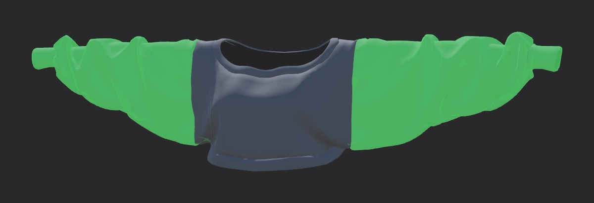
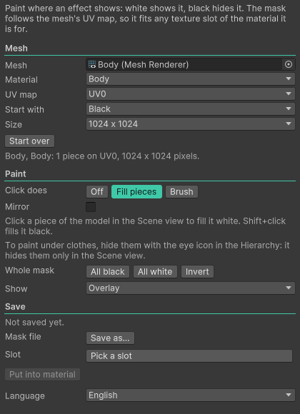
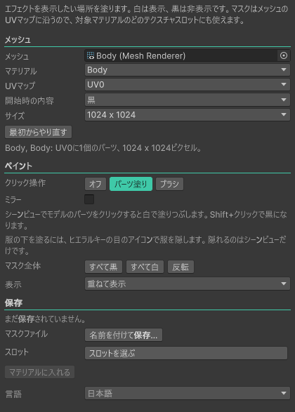

# DocMe Mask Painter

Paint black and white masks for your avatar right on the model in the Scene view. White shows an effect, black hides it. The mask is laid out on the mesh's UV map, so it fits any texture slot of the material it is for: a Poiyomi emission mask, a glitter mask, the DocMe Skin Touch mask and so on. Any shader works. For shaders that read a different mask from each colour channel, you can paint one channel at a time.

The window is in English and Japanese: pick the language at its top right.

 

## Install

1. Open my VCC listing page, https://docmevr.github.io/vpm, and press **Add to VCC**. The VRChat Creator Companion then knows my tools and keeps them up to date.
2. In the Creator Companion, open **Manage Project** for your avatar project and add **DocMe Mask Painter**.

Optional, without the Creator Companion: download the `.unitypackage` from the [latest release](https://github.com/DocMeVR/mask-painter/releases/latest) and import it into your project (**Assets > Import Package > Custom Package...**). It needs Unity 2022.3, the version the Creator Companion installs.

## Use

1. Open **Tools > DocMe > Mask Painter**. A selected mesh is already in **Mesh**; if not, drag one in from the Hierarchy (for example Body). Pick the **Material** the mask is for. Leave **UV map** on UV0 unless that material reads its mask from another UV map.
2. To keep painting a mask you already have, drag it into **Texture** or press **From the material**. The tool finds the mesh and material that use it. Or right-click the texture in the Project window and pick **DocMe > Paint in Mask Painter**. For a new mask, leave **Texture** empty and pick **New mask** (Black or White) and its **Size**.
3. Press **Paint this texture** (or **Start painting** for a new mask). The painting tools show in the **Mask Painter** panel in the Scene view.
4. Pick a tool at the top of the panel. **Fill pieces** fills the piece of the model you click, **Brush** paints where you drag, and **Smooth** softens an edge you drag over. Shift paints the other colour. Tick **Mirror** to paint both sides at once.
5. Press **Save** (or **Save as...** for a new file). For a new mask, press the **Slot** button, type part of the slot's name (for example "emission"), pick it and press **Put into material**.

## Shortcuts

| Key | Does |
|---|---|
| B, G, S | Brush, Fill pieces, Smooth |
| X | Swaps white and black |
| Shift | Paints the other colour while held |
| Ctrl+click | Picks the grey under the mouse |
| [ and ], Ctrl+mouse wheel | Brush size |
| Ctrl+Z, Ctrl+Y | Undo, redo |
| Alt+drag | Turns the view while you paint |

The letter keys work only while a painting is open and the Scene view has focus. Change them in **Edit > Shortcuts** under **Mask Painter**.

## Tips

- **Select** at the top of the panel gives your clicks back to selecting objects.
- The brush size is in centimetres on the model, and a stroke carries across UV seams. The brush paints only the side you aim at, so a stroke on the palm leaves the back of the hand alone.
- With a drawing tablet, **Pen pressure** makes the brush smaller when you press lightly (**Size**, on by default) or paint less (**Strength**).
- **Paint: Add** moves the mask toward the colour you paint by **Strength**, so low values build up greys over several strokes. **Paint: Replace** paints one exact **Grey level**.
- **Paint into** picks the colour channel you paint: **All channels (grey)** for a plain mask, or **Red**, **Green**, **Blue** or **Alpha** alone. Each channel shows in its own colour. **Show: Every channel** shows red, green and blue together, handy for masks like Skin Touch's that use two channels. **Copy from...** copies another channel into the one you paint.
- **UV seams: Even out** gives both sides of every UV seam the same value. Use it when a dent or an effect shows a thin line along a seam.
- To paint under clothes, tick **Only this mesh**. It hides everything else in the Scene view until you untick it or close the window.
- The window shows your mask on the UV map with each piece's outline, and a ring where the mouse is on the model.
- The Scene view panel is hidden? Press the ` key in the Scene view and turn on **Mask Painter**.
- A piece is a part of the UV map that hangs together. UV seams split the model into pieces, which is why a click on the chest can fill the whole torso.
- Only the part of the mesh drawn with the chosen material is painted.
- A PNG in your project is saved back into itself. The first **Save** asks before it replaces the file, and offers a new file instead. Every channel and its size are kept.
- A locked Poiyomi material lists only the slots of features that are on. A mask put into a slot that was empty when the material was locked may only show after you unlock and lock the material again.
- A material inside a model file (FBX) cannot keep changes. Extract it to its own file first.
- Closing the window, maximizing the Scene view or a script reload keeps your painting. Unity asks you to save it when you quit.

## What it changes

Nothing on your avatar changes while you paint. The overlay is drawn by the window, not by your materials. **Save** writes one PNG, imported as a linear (sRGB off), clamped texture at its full size, because a mask holds amounts rather than colours. On PC it gets the format that keeps what you painted with smooth gradients at the smallest size: BC4 when only red holds paint, BC5 for red and green, BC7 for anything else (a grey mask too). Quest and other platforms keep Unity's format, unless it would drop a channel you painted. A painted alpha is kept as an amount, never as see-through. **Put into material** sets one texture slot of one material, and Ctrl+Z takes it out again.

## How this was made

The code in this repository was written by AI (Claude, by Anthropic). The idea, the design, every feature, the testing on real avatars and the decisions on how it should behave are mine (DocMe). I planned it and directed the work; the AI typed it out. Bug reports and pull requests are welcome, and anything that gets merged goes through my own review.

## License

MIT. See `LICENSE.md`.
